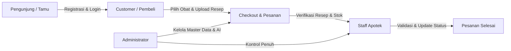
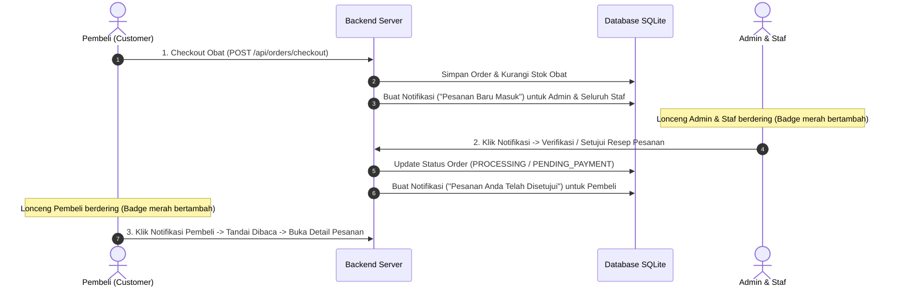

# APOTEK SEHAT
### Sistem Pemesanan Obat Apotek Berbasis Web dengan AI Assistant

[](https://github.com/)
[](https://react.dev/)
[](https://www.typescriptlang.org/)
[](https://vitejs.dev/)
[](https://www.prisma.io/)
[](https://www.sqlite.org/)
[](https://github.com/)

Dokumentasi resmi repositori proyek perangkat lunak **APOTEK SEHAT**, dikembangkan untuk memenuhi tugas Proyek Akhir Mata Kuliah **Rekayasa Perangkat Lunak**, Program Studi S1 Teknik Informatika, STMIK IKMI Cirebon.

---

## 📋 DAFTAR ISI

- [Identitas Pengembang](#-identitas-pengembang)
- [Tema Kelompok](#-tema-kelompok)
- [Tentang Project](#-tentang-project)
- [Fitur Aplikasi](#-fitur-aplikasi)
- [Sistem Notifikasi Pemesanan](#-sistem-notifikasi-pemesanan)
- [AI Assistant](#-ai-assistant)
- [Teknologi yang Digunakan](#-teknologi-yang-digunakan)
- [Struktur Folder](#-struktur-folder)
- [Setup Instruction](#-setup-instruction)
- [Cara Menjalankan Aplikasi](#-cara-menjalankan-aplikasi)
- [Troubleshooting](#-troubleshooting)
- [Video Dokumentasi](#-video-dokumentasi)
- [Keamanan](#-keamanan)
- [Informasi Pengumpulan](#-informasi-pengumpulan)

---

## 👤 IDENTITAS PENGEMBANG

| Data Mahasiswa | Keterangan |
| :--- | :--- |
| **Nama Lengkap** | **ADE IRAWAN** |
| **NIM** | **41257082** |
| **Kelas** | **1A-2025** |
| **Kelompok** | **Kelompok 4** |
| **Program Studi** | S1 Teknik Informatika |
| **Institusi** | STMIK IKMI Cirebon |
| **Mata Kuliah** | Rekayasa Perangkat Lunak |
| **Tahun Akademik** | 2025/2026 |

> **Anggota Pengembang Tambahan (Sub-Tim APOTEK SEHAT):**  
> Proyek APOTEK SEHAT ini dikerjakan secara kolaboratif oleh Ade Irawan bersama satu anggota Kelompok 4 lainnya:  
> - Anggota 2: `[MASUKKAN NAMA ANGGOTA KELOMPOK 2]` (NIM: `[MASUKKAN NIM ANGGOTA KELOMPOK 2]`)

---

## 🎯 TEMA KELOMPOK

Tema besar yang diusung oleh **Kelompok 4** adalah:

> **"Pengembangan Aplikasi Layanan Digital Berbasis Web"**

Tema ini dirancang untuk menjawab tantangan digitalisasi layanan publik dan komersial dengan mengimplementasikan dua pilar aplikasi yang saling melengkapi di bawah naungan kelompok yang sama:

1. **APOTEK SEHAT** *(Repository Ini)*  
   Sistem Pemesanan Obat Apotek Berbasis Web dengan AI Assistant yang berfokus pada digitalisasi layanan kefarmasian, validasi resep dokter daring, manajemen stok obat, sistem notifikasi otomatis antar-peran, serta integrasi konsultasi cerdas berbasis kecerdasan buatan.
2. **Course / E-Learning** *(Repository Terpisah)*  
   Platform Pembelajaran dan Kursus Online interaktif yang dikembangkan oleh anggota Kelompok 4 lainnya untuk mendemokratisasi akses materi pembelajaran digital.

> [!NOTE]  
> Dokumentasi teknis dalam repositori ini secara eksklusif membahas aplikasi **APOTEK SEHAT**. Seluruh arsitektur, instalasi, basis data, dan fitur yang dijabarkan berlaku khusus untuk sistem informasi apotek digital ini.

---

## 📖 TENTANG PROJECT

**APOTEK SEHAT** adalah aplikasi manajemen apotek dan pemesanan obat daring modern yang menghubungkan pelanggan (*Customer*), staf operasional farmasi (*Staff Apotek*), dan administrator apotek (*Admin*) dalam satu platform terpadu berbasis web.

### Permasalahan yang Diselesaikan
- **Antrean Fisik & Aksesibilitas**: Mempermudah masyarakat memperoleh obat-obatan umum maupun obat keras tanpa perlu mengantre secara fisik di apotek.
- **Validasi Resep Dokter Digital**: Mengurangi risiko kesalahan pembacaan resep dan penyalahgunaan obat keras (*ethical drugs*) melalui modul unggah resep dan verifikasi bertingkat oleh staf apoteker resmi.
- **Transparansi Stok & Notifikasi Instan**: Mencegah kekecewaan pembeli akibat stok kosong dengan sinkronisasi inventaris *real-time* serta sistem notifikasi otomatis terpadu (In-App Navbar Dropdown, WhatsApp Gateway Fonnte, dan Telegram Bot API).
- **Konsultasi Farmasi Berbantuan AI**: Menyediakan asisten kecerdasan buatan cerdas yang memahami basis data obat lokal, aturan pakai, dosis, dan kontraindikasi umum selama 24/7.

---

## ✨ FITUR APLIKASI

Aplikasi telah diuji dan berjalan secara penuh (*fully functional*) dengan pemisahan peran berbasis **Role-Based Access Control (RBAC)**:



### A. Fitur Pembeli (Customer)
- **Registrasi & Autentikasi Pengguna**: Pendaftaran akun baru, login aman menggunakan enkripsi kata sandi `bcryptjs`, dan pengelolaan sesi pengguna berbasis JWT (*JSON Web Token*).
- **Katalog Obat Interaktif**: Penjelajahan sediaan obat dengan filter multi-kategori (Obat Bebas, Obat Bebas Terbatas, Obat Keras, Suplemen/Vitamin, Alat Kesehatan) beserta penandaan status ketersediaan stok.
- **Pencarian Real-Time**: Pencarian obat cepat berdasarkan nama produk, indikasi, atau deskripsi obat.
- **Detail Obat Komprehensif**: Menampilkan informasi dosis, komposisi, indikasi terapi, aturan pakai, efek samping, harga satuan, dan label kewajiban resep dokter (*prescription required*).
- **Asisten AI Farmasi**: Konsultasi keluhan umum, pencarian rekomendasi obat yang sesuai, dan tanya-jawab aturan pakai langsung melalui floating chat widget.
- **Keranjang Belanja Tersinkronisasi**: Penambahan item obat, pengaturan kuantitas obat, validasi batas stok otomatis, dan sinkronisasi server-side database.
- **Checkout & Pengunggahan Resep Dokter**: 
  - Pengisian alamat pengiriman lengkap dan catatan pesanan.
  - Modul unggah foto resep dokter (format gambar/dokumen) khusus untuk obat berkategori keras.
  - Ringkasan rincian biaya, ongkos kirim, dan total pembayaran.
- **Riwayat & Pelacakan Status Pesanan**: 
  - Melihat riwayat seluruh transaksi pesanan.
  - Memantau tahapan status pesanan secara *real-time* (`PENDING_VERIFICATION`, `PENDING_PAYMENT`, `CONFIRMED`, `PROCESSING`, `SHIPPED`, `COMPLETED`, `CANCELLED`).
  - Mengetahui alasan penolakan resep secara transparan apabila pesanan ditolak oleh apoteker.
- **Notifikasi Pemesanan Real-Time**: 
  - Ikon lonceng interaktif pada navbar dengan badge merah jumlah notifikasi baru.
  - Menerima notifikasi otomatis saat pesanan disetujui, ditolak (disertai alasan penolakan transparan), dan saat status pesanan berubah (diproses, siap diambil, dikirim kurir, selesai).
  - Mengklik notifikasi langsung mengarahkan pembeli ke halaman detail pesanan yang bersangkutan.

### B. Fitur Staf Apotek (Staff)
- **Portal Staf Terproteksi**: Login khusus staf apotek dengan hak akses operasional terbatas (tidak dapat melihat laporan laba rugi atau data finansial global).
- **Notifikasi Pesanan Masuk Real-Time**: Lonceng notifikasi berbunyi dan badge bertambah otomatis saat customer menyelesaikan pesanan obat, mengarahkan staf langsung ke verifikasi pesanan.
- **Pemantauan Antrean Pesanan Masuk**: Daftar seluruh pesanan aktif yang membutuhkan tindak lanjut operasional.
- **Inspeksi Resep Dokter**: Antarmuka peninjauan berkas resep dokter beresolusi tinggi yang diunggah oleh pelanggan.
- **Validasi Resep (Setujui / Tolak)**:
  - Tombol persetujuan resep dokter untuk melanjutkan pesanan ke tahap pembayaran/pemrosesan.
  - Fitur penolakan resep disertai input alasan penolakan resmi (misal: "Resep kedaluwarsa" atau "Dosis tidak terbaca").
- **Pembaruan Status Pengiriman**: Mengubah status tahapan pesanan dari diproses, siap diambil, sedang dikirim kurir, hingga selesai diterima pembeli.
- **Pengelolaan Inventaris & Stok Obat**: Pemantauan jumlah sediaan obat di rak dan gudang secara langsung.

### C. Fitur Administrator (Admin)
- **Sidebar Admin Dashboard Modern**: Tata letak admin profesional dengan sidebar vertikal, kartu ringkasan metrik (Total Obat, Kategori, Pelanggan, Pesanan Menunggu, Omzet Toko), dan topbar independen.
- **Pusat Notifikasi Admin Terintegrasi**: Lonceng notifikasi hadir di navbar publik dan topbar dashboard admin. Notifikasi instan pesanan baru masuk, peringatan obat stok kritis, serta tombol tandai semua dibaca.
- **Manajemen Sediaan Obat (CRUD)**: Menambah obat baru, menyunting nama/harga/stok/unit, mengatur status resep wajib, mengunggah foto obat, serta menonaktifkan sediaan obat.
- **Manajemen Kategori Farmasi (CRUD)**: Menambah kategori terapi baru, mengubah deskripsi, dan menghapus kategori.
- **Manajemen Pengguna & Staf**: Mengelola akun staf dan pembeli, melihat data kontak, serta mengaktifkan/menonaktifkan akses pengguna.
- **Pemantauan Seluruh Transaksi & Laporan Keuangan**: Rekapitulasi transaksi, total omzet masuk, status pembayaran, dan riwayat pesanan apotek.
- **Konfigurasi AI Multi-Provider**: Pengaturan dinamis penyedia AI (Google Gemini, OpenAI, NVIDIA NIM, Groq, OpenRouter), pemilihan model LLM, penyimpanan API key terenkripsi AES-256-GCM, dan tombol uji koneksi live.
- **Gateway Notifikasi Otomatis (WhatsApp & Telegram)**:
  - **Fonnte WhatsApp Gateway**: Pengaturan token API, nomor admin tujuan, dan pengiriman notifikasi otomatis saat pesanan masuk/berubah status.
  - **Telegram Bot API**: Konfigurasi token bot Telegram dan Chat ID untuk pengiriman log peringatan operasional dan stok kritis.

---

## 🔔 SISTEM NOTIFIKASI PEMESANAN

Aplikasi **APOTEK SEHAT** menerapkan sistem notifikasi berbasis basis data (*database-driven*) yang terintegrasi secara *real-time* antara transaksi pembeli, penanganan staf farmasi, dan pengawasan administrator.



### 1. Alur Otomatisasi Notifikasi

| Peristiwa Transaksi | Penerima Notifikasi | Judul Notifikasi | Format Isi Pesan |
| :--- | :--- | :--- | :--- |
| **Pembeli Melakukan Checkout** | **Admin & Seluruh Staf** | `Pesanan Baru Masuk` | *Pembeli [Nama] telah melakukan pemesanan obat dengan nomor pesanan #[Kode]. Total: Rp [Nominal] ([Jumlah] jenis obat). Status: [Status].* |
| **Admin / Staf Menyetujui Pesanan** | **Pembeli Pemilik Pesanan** | `Pesanan Anda Telah Disetujui` | *Pesanan Anda dengan nomor #[Kode] telah disetujui dan sedang diproses oleh pihak apotek.* |
| **Admin / Staf Menolak Pesanan** | **Pembeli Pemilik Pesanan** | `Pesanan Tidak Dapat Diproses` | *Mohon maaf, pesanan Anda dengan nomor #[Kode] tidak dapat diproses. Alasan penolakan: "[Alasan]". Silakan periksa detail pesanan atau hubungi pihak apotek.* |
| **Pembaruan Status Pesanan** | **Pembeli Pemilik Pesanan** | `Pesanan Sedang Diproses` / `Pesanan Siap Diambil` / `Pesanan Sedang Dikirim` / `Pesanan Selesai` / `Pesanan Dibatalkan` | Pesan kontekstual sesuai tahapan pengiriman kurir, pengambilan di apotek, atau penyelesaian transaksi. |

### 2. Multi-Channel Notification Gateway
Selain notifikasi in-app pada antarmuka web, sistem secara paralel (*non-blocking*) meneruskan pesan ke kanal komunikasi eksternal:
- **In-App Navbar Dropdown**: Tersimpan permanen di tabel SQLite `notifications` dengan pelacakan status dibaca (*is_read*).
- **Fonnte WhatsApp Gateway**: Mengirimkan pesan WhatsApp resmi ke nomor telepon admin (`085767646273`) dan nomor handphone pembeli.
- **Telegram Bot API**: Mengirimkan pesan Markdown instan ke grup/chat staf dan admin apotek.

### 3. Model Basis Data Notifikasi (Prisma ORM)

Notifikasi disimpan dalam tabel **`notifications`** dengan struktur data berikut:

```prisma
model Notification {
  id        String   @id @default(cuid())
  userId    String   @map("user_id")
  title     String
  message   String
  type      String   @default("order_status") // new_order | order_approved | order_rejected | order_status | low_stock | prescription_status
  orderId   String?  @map("order_id")
  isRead    Boolean  @default(false) @map("is_read")
  createdAt DateTime @default(now()) @map("created_at")

  // Relasi terindeks
  user      User     @relation(fields: [userId], references: [id], onDelete: Cascade)
  order     Order?   @relation(fields: [orderId], references: [id], onDelete: Cascade)

  @@index([userId])
  @@index([userId, isRead])
  @@index([orderId])
  @@index([createdAt])
  @@map("notifications")
}
```

### 4. Fitur Antarmuka Dropdown Notifikasi
- **Ikon Lonceng & Badge Jumlah**: Menampilkan jumlah notifikasi yang belum dibaca (*unread count*).
- **Ikon Dinamis Sesuai Jenis**:
  - 🛍️ `new_order` (Ikon tas pesanan biru).
  - ✅ `order_approved` (Ikon centang hijau sukses).
  - ❌ `order_rejected` (Ikon lingkaran merah penolakan).
  - 🕒 `order_status` (Ikon jam toska proses pesanan).
  - ⚠️ `low_stock` (Ikon boks kuning peringatan stok menipis).
  - 📄 `prescription_status` (Ikon dokumen biru resep).
- **Indikator Unread**: Penanda titik hijau terang (*green dot indicator*) dan latar belakang lembut yang membedakan notifikasi baru dengan notifikasi yang sudah dibaca.
- **Tindakan Interaktif**:
  - Tombol **"Tandai semua dibaca"** untuk membersihkan badge dalam 1 klik.
  - Klik per item notifikasi otomatis menandai notifikasi tersebut sebagai dibaca dan mengarahkan pengguna ke halaman detail pesanan yang bersangkutan.
- **Pembaruan Reaktif Tanpa Refresh**:
  - Menggunakan polling periodik efisien setiap 8 detik di latar belakang via `NotificationContext.tsx` sehingga data badge dan isi dropdown bertambah seketika saat ada pesanan baru atau perubahan status.

### 5. Hasil Pengujian Otomatis Sistem Notifikasi (`scripts/test_notifications.ts`)

Telah diverifikasi menggunakan skrip pengujian integrasi database:

```text
--- STARTING NOTIFICATION SYSTEM INTEGRATION TESTS ---
[TEST 1] Triggering notifyOrderCreatedInApp...
✅ SUCCESS: Admin received: "Pesanan Baru Masuk"
✅ SUCCESS: Staff received: "Pesanan Baru Masuk"

[TEST 2] Triggering notifyOrderApprovedInApp...
✅ SUCCESS: Customer received: "Pesanan Anda Telah Disetujui"

[TEST 3] Triggering notifyOrderRejectedInApp with reason...
✅ SUCCESS: Customer received: "Pesanan Tidak Dapat Diproses" (Alasan terverifikasi)

[TEST 4] Triggering notifyOrderStatusChangedInApp...
✅ SUCCESS: Status notifications recorded (READY_FOR_PICKUP & SHIPPED)

[TEST 5] Testing markAsRead and markAllAsRead...
✅ SUCCESS: Single notification marked as read & All marked as read (Unread count: 0)

[TEST 6] Testing RBAC Isolation...
✅ SUCCESS: RBAC strict isolation confirmed with zero leakage between users.

🎉 ALL 6 NOTIFICATION INTEGRATION TESTS PASSED PERFECTLY!
```

---

## 🤖 AI ASSISTANT

Aplikasi APOTEK SEHAT dilengkapi dengan asisten cerdas virtual yang terintegrasi secara *native* pada antarmuka pengguna dan terhubung ke backend server yang aman.

```
[ Antarmuka Frontend: AIChatWidget ]
                 │ (REST API: /api/ai/chat + JWT Token)
                 ▼
[ Server Backend: apiHandler.ts ]
                 │
                 ├──► [ aiDataAccess.ts ]: Mengambil konteks obat & role pengguna dari SQLite
                 │
                 └──► [ aiProviderService.ts ]: Memilih provider aktif (Gemini / OpenAI / NVIDIA / Groq)
                                 │
                                 ▼
                     (Panggilan Model LLM Eksternal)
```

### 1. Tujuan AI Assistant
- Memberikan informasi edukatif seputar sediaan obat, indikasi terapi umum, serta cara konsumsi yang tepat kepada pelanggan apotek.
- Membantu pencarian produk yang tersedia di katalog apotek berdasarkan gejala atau keluhan ringan pembeli.
- Membantu admin mendapatkan wawasan ringkas mengenai data inventaris toko.

### 2. Cara Penggunaan
1. Pengguna mengeklik ikon melayang (*floating button*) **AI Assistant** di pojok kanan bawah layar pada halaman mana pun.
2. Pengguna mengetik pertanyaan (contoh: *"Obat apa yang cocok untuk flu disertai sakit kepala dan tidak menyebabkan kantuk?"*).
3. AI memproses pertanyaan dan memberikan jawaban interaktif beserta rekomendasi obat yang relevan dari katalog toko.

### 3. Proses Komunikasi & Akses Data (Role-Aware Context)
- Komunikasi dikirimkan melalui endpoint `/api/ai/chat` di sisi backend Node.js.
- Sistem menerapkan pembatasan data berbasis peran (**RBAC Data Access Layer** pada `src/server/aiDataAccess.ts`):
  - **Customer**: Hanya diberikan informasi katalog publik dan data pesanan miliknya sendiri. Tidak dapat mengakses omzet apotek atau data pembeli lain.
  - **Staff**: Diberikan konteks antrean resep dan stok obat. Data omzet dan akun admin tetap dirahasiakan.
  - **Admin**: Diberikan konteks ringkasan analitik menyeluruh (omzet, total obat kritis, tren pesanan).
- Kredensial rahasia seperti hash password, token JWT, dan API Key sistem diproteksi secara ketat dan tidak pernah dimasukkan ke dalam prompt model AI.

### 4. Provider & Model AI yang Didukung
Arsitektur AI pada proyek ini bersifat dinamis (**Multi-Provider**) dan dikonfigurasikan melalui modul `src/server/services/aiProviderService.ts`:

| Provider AI | Model Default | Alternatif Model yang Didukung |
| :--- | :--- | :--- |
| **Google Gemini** *(Utama)* | `gemini-2.5-flash` | `gemini-2.5-pro`, `gemini-2.0-flash`, `gemini-1.5-flash`, `gemini-1.5-pro` |
| **OpenAI** | `gpt-4o-mini` | `gpt-4.1-mini`, `gpt-4o`, `o3-mini`, `gpt-3.5-turbo` |
| **NVIDIA NIM** | `meta/llama-3.2-11b-vision-instruct` | `meta/llama-3.1-70b-instruct`, `mistralai/mistral-large-2-instruct` |
| **Groq** | `llama-3.3-70b-versatile` | `llama-3.1-8b-instant`, `mixtral-8x7b-32768`, `gemma2-9b-it` |
| **OpenRouter / Lainnya** | Sesuai konfigurasi admin | Model open-source berbasis endpoint kompatibel OpenAI |

### 5. Penanganan Error (Fault Tolerance)
- Jika provider aktif mengalami kegagalan (*rate limit*, kuota habis, atau kendala jaringan), sistem menangkap error dan mengembalikan pesan informatif yang ramah pengguna.
- Tersedia fitur *fallback provider* dan pencatatan riwayat error pada tabel database `ai_providers` kolom `last_error` agar admin dapat segera mengidentifikasi penyebab gangguan.

> [!CAUTION]  
> **DISCLAIMER MEDIS PENTING:**  
> AI Assistant pada aplikasi APOTEK SEHAT dirancang murni sebagai sarana edukasi informasi dan asisten navigasi katalog apotek. Jawaban AI **BUKAN PENGGANTI** diagnosis medis, konsultasi dokter, instruksi resep resmi, atau advis apoteker profesional berlisensi.

---

## 💻 TEKNOLOGI YANG DIGUNAKAN

Seluruh teknologi yang tercantum di bawah ini diverifikasi langsung dari berkas konfigurasi `package.json`, `prisma/schema.prisma`, dan arsitektur *source code*:

### 1. Frontend
- **Library Utama**: [React 18.3.1](https://react.dev/) (Single Page Application / Component-Driven).
- **Bahasa Pemrograman**: [TypeScript 5.7.3](https://www.typescriptlang.org/) (Strict static typing).
- **Build Tool & Dev Server**: [Vite 6.1.0](https://vitejs.dev/) with `@vitejs/plugin-react`.
- **Ikon Antarmuka**: [Lucide React 0.475.0](https://lucide.dev/).
- **Sistem Desain UI**: Vanilla CSS Design System terstruktur (`src/styles/` meliputi variabel CSS, dark mode, responsive breakpoints, dan komponen UI).

### 2. Backend & API Server
- **Server Middleware**: Vite Custom Connect-compatible API Middleware Plugin (`src/server/apiHandler.ts`), menangani rute `/api/*` secara *seamless* di lingkungan pengembangan lokal tanpa memerlukan proses server terpisah.
- **Runtime Environment**: [Node.js](https://nodejs.org/) (ES Modules).
- **Autentikasi & Keamanan Sesi**: [JSON Web Token (jsonwebtoken 9.0.3)](https://github.com/auth0/node-jsonwebtoken).
- **Enkripsi Kata Sandi**: [bcryptjs 3.0.3](https://github.com/dcodeIO/bcrypt.js).
- **Enkripsi Data Kredensial**: Modul bawaan Node.js `crypto` menggunakan cipher **AES-256-GCM** (untuk enkripsi API Key AI dan token WhatsApp).

### 3. Basis Data & ORM
- **Database Engine**: [SQLite](https://www.sqlite.org/) (Disimpan dalam berkas database lokal, cocok untuk portabilitas dan demonstrasi akademik).
- **Object-Relational Mapping (ORM)**: [Prisma ORM 5.22.0](https://www.prisma.io/) (`@prisma/client` & `prisma CLI`).
- **Database Seeder**: `tsx 4.23.12` untuk mengeksekusi `prisma/seed.ts`.

### 4. Layanan Pihak Ketiga & Integrasi Eksternal
- **AI SDK**: `@google/generative-ai 0.24.1` (Google Gemini API) serta protokol REST API untuk OpenAI, NVIDIA NIM, dan Groq.
- **WhatsApp Gateway**: Fonnte API (`https://api.fonnte.com/send`).
- **Telegram Bot API**: Telegram REST Bot Gateway (`https://api.telegram.org`).

---

## 📁 STRUKTUR FOLDER

Berikut adalah struktur direktori aktual proyek **APOTEK SEHAT**:

```text
apotek-sehat/
├── .vscode/                     # Konfigurasi editor VS Code
├── dist/                        # Hasil kompilasi produksi (vite build)
├── node_modules/                # Paket dependensi proyek
├── prisma/                      # Konfigurasi basis data & ORM
│   ├── dev.db                   # Berkas database SQLite lokal
│   ├── schema.prisma            # Skema tabel (User, Order, Notification, Medicine, dsb.)
│   └── seed.ts                  # Berkas seeder data awal aplikasi
├── public/                      # Aset statis publik
│   ├── favicon.svg              # Ikon browser
│   ├── images/                  # Aset gambar katalog obat
│   └── uploads/                 # Direktori penyimpanan unggahan resep dokter
│       └── prescriptions/
├── scripts/                     # Skrip otomatisasi dan pengujian sistem
│   ├── test_notifications.ts    # Skrip pengujian integrasi otomatis notifikasi pemesanan
│   ├── test_ai_rbac.mjs         # Skrip pengujian hak akses RBAC chatbot AI
│   ├── test_telegram.mjs        # Skrip verifikasi integrasi bot Telegram
│   └── verify-*.ts              # Skrip verifikasi database, staf, dan pesanan
├── src/                         # Source code utama aplikasi
│   ├── components/              # Komponen antarmuka React
│   │   ├── ai/                  # Widget floating chatbot AI Assistant
│   │   ├── auth/                # Modal login, registrasi, & rute terproteksi
│   │   ├── cart/                # Drawer keranjang belanja
│   │   ├── catalog/             # Tampilan katalog & kartu detail obat
│   │   ├── checkout/            # Alur checkout & upload resep dokter
│   │   ├── common/              # Komponen reusable (Button, Modal, NotificationDropdown, Toast)
│   │   ├── dashboard/           # Dashboard Admin, Staf Apotek, & Profil Customer
│   │   ├── home/                # Bagian beranda (Hero, Kategori, Produk Unggulan)
│   │   ├── layout/              # Navbar publik dan Footer aplikasi
│   │   └── order/               # Riwayat pesanan & pelacakan status
│   ├── context/                 # State management berbasis React Context
│   │   ├── AuthContext.tsx      # Manajemen sesi login & hak akses
│   │   ├── CartContext.tsx      # Manajemen item keranjang belanja
│   │   ├── NotificationContext.tsx # Manajemen notifikasi in-app real-time (polling 8s)
│   │   ├── ThemeContext.tsx     # Manajemen tema light / dark mode
│   │   └── ToastContext.tsx     # Manajemen feedback pop-up toast
│   ├── data/                    # Data tiruan awal (mockData.ts)
│   ├── lib/                     # Utilitas database & helper fungsi
│   │   ├── db.ts                # Inisialisasi Prisma Client singleton
│   │   └── validations.ts       # Validasi format input data
│   ├── server/                  # Backend API handler & business logic
│   │   ├── controllers/         # Kontroler rute API (auth, order, staff, admin, notification)
│   │   │   ├── notificationController.ts # Endpoint API notifikasi (/api/notifications)
│   │   │   ├── orderController.ts        # Checkout order & pemicu notifikasi order
│   │   │   └── staffController.ts        # Verifikasi resep & pemicu notifikasi status
│   │   ├── services/            # Layanan integrasi (AI Provider, Fonnte, Telegram, Notification)
│   │   │   └── notificationService.ts    # Service pembuatan notifikasi otomatis ke database
│   │   ├── aiDataAccess.ts      # Query database berbasis RBAC untuk AI
│   │   ├── apiHandler.ts        # Dispatcher utama request API backend
│   │   ├── auth.ts              # Middleware JWT token verification
│   │   ├── crypto.ts            # Enkripsi & dekripsi rahasia AES-256-GCM
│   │   ├── rateLimiter.ts       # Pengaman laju request API
│   │   └── types.ts             # Definisi tipe request & response API
│   ├── services/                # HTTP API Client layer untuk frontend
│   ├── styles/                  # Berkas tata gaya CSS terstruktur
│   ├── types/                   # Definisi antarmuka TypeScript global
│   ├── App.tsx                  # Komponen induk router & layout switcher
│   └── main.tsx                 # Titik awal eksekusi aplikasi React
├── .env.example                 # Template berkas environment variabel
├── .gitignore                   # Daftar berkas/folder yang diabaikan oleh Git
├── index.html                   # Halaman HTML utama aplikasi
├── package.json                 # Metadata proyek, skrip, dan daftar dependensi
├── README.md                    # Dokumentasi utama proyek (berkas ini)
├── tsconfig.json                # Konfigurasi compiler TypeScript
└── vite.config.ts               # Konfigurasi bundler Vite & API middleware
```

---

## 🛠️ SETUP INSTRUCTION

Petunjuk instalasi ini dikhususkan untuk sistem operasi **Windows** menggunakan shell PowerShell atau Command Prompt (`cmd.exe`).

### Persyaratan Sistem
Pastikan perangkat Anda telah terpasang:
1. **Node.js** (Disarankan versi LTS v18.x atau v20.x).
2. **npm** (Dijalankan menggunakan `npm.cmd` pada lingkungan Windows).
3. **Git for Windows** (Untuk mengkloning repositori).
4. Browser modern (Google Chrome, Microsoft Edge, atau Mozilla Firefox).

---

### Langkah 1 – Clone Repository

Buka terminal PowerShell atau Command Prompt, kemudian jalankan:

```bash
git clone [URL_REPOSITORY_GITHUB]
```

### Langkah 2 – Masuk ke Folder Project

```bash
cd [NAMA_FOLDER_PROJECT]
```
*(cd apotek-sehat)*

### Langkah 3 – Install Dependencies

> [!IMPORTANT]  
> Sesuai konfigurasi pada lingkungan Windows, instalasi dependensi **WAJIB** dijalankan melalui perintah `npm.cmd`:

```bash
npm.cmd install
```

Tunggu hingga seluruh paket pada `node_modules` selesai diunduh.

### Langkah 4 – Konfigurasi Environment (`.env`)

Buat berkas baru bernama `.env` pada direktori utama proyek dengan menduplikasi contoh konfigurasi:

```bash
copy .env.example .env
```

Buka berkas `.env` tersebut menggunakan editor teks (misalnya VS Code) dan sesuaikan variabel lingkungannya:

```env
# ==========================================
# KONFIGURASI DATABASE (SQLite)
# ==========================================
DATABASE_URL="file:./dev.db"

# ==========================================
# KEAMANAN JWT
# ==========================================
JWT_SECRET="masukkan_string_acak_panjang_untuk_jwt_secret"

# ==========================================
# KONFIGURASI AI ASSISTANT (Pilih Salah Satu / Keduanya)
# ==========================================
# Kunci API Google Gemini (Dapatkan di https://aistudio.google.com/)
GEMINI_API_KEY=""

# Kunci API NVIDIA NIM (Alternatif)
NVIDIA_API_KEY=""
NVIDIA_MODEL="meta/llama-3.2-11b-vision-instruct"

# ==========================================
# NOTIFIKASI GATEWAY (Opsional)
# ==========================================
# WhatsApp Gateway (Fonnte)
FONNTE_TOKEN=""
FONNTE_ADMIN_PHONE="085767646273"

# Telegram Bot Gateway
TELEGRAM_BOT_TOKEN=""
TELEGRAM_ADMIN_CHAT_ID=""
TELEGRAM_STAFF_CHAT_ID=""
TELEGRAM_NOTIFICATIONS_ENABLED="false"
```

> [!WARNING]  
> **JANGAN PERNAH** mempublikasikan atau mengunggah nilai asli API Key atau token Anda ke repositori GitHub publik! Pastikan file `.env` selalu tercantum dalam `.gitignore`.

### Langkah 5 – Menyiapkan Basis Data (Prisma ORM)

Jalankan perintah sinkronisasi skema basis data SQLite dan generate client:

```bash
npx.cmd prisma generate
npx.cmd prisma db push
```

Isi basis data dengan akun awal (*Admin*, *Staff*, *Customer*) dan katalog obat awal menggunakan seeder:

```bash
npm.cmd run seed
```

Jalankan skrip uji integrasi notifikasi untuk memastikan basis data telah siap sepenuhnya:

```bash
npx.cmd tsx scripts/test_notifications.ts
```

> **Akun Bawaan Seeder untuk Pengujian:**
> - **Admin**: Email `ade.irawan@gmail.com` | Password: `password123`
> - **Staff**: Email `siti.aminah@apoteksehat-ai.com` | Password: `password123`
> - **Customer**: Email `budi.santoso@gmail.com` | Password: `password123`

---

## 🚀 CARA MENJALANKAN APLIKASI

### Langkah 1 – Menjalankan Server Pengembangan

> [!IMPORTANT]  
> Eksekusi perintah menjalankan server lokal di komputer Windows **WAJIB** menggunakan:

```bash
npm.cmd run dev
```

Server pengembangan Vite beserta API Middleware backend akan mulai berjalan.

### Langkah 2 – Membuka Aplikasi di Browser

Buka peramban web Anda dan akses alamat lokal resmi proyek:

👉 **[http://localhost:3000](http://localhost:3000)**

### Langkah 3 – Menghentikan Aplikasi

Untuk mematikan proses server, kembali ke jendela terminal tempat aplikasi berjalan dan tekan kombinasi tombol:

```text
Ctrl + C
```
Pilih `Y` jika muncul konfirmasi untuk menghentikan batch job.

---

## ❓ TROUBLESHOOTING

| Gejala Masalah | Kemungkinan Penyebab | Solusi Penanganan |
| :--- | :--- | :--- |
| **`npm.cmd` tidak dikenali sebagai perintah internal atau eksternal** | Path Node.js belum terdaftar pada variabel lingkungan (*System PATH*) Windows. | Buka *Environment Variables* di Windows, tambahkan path instalasi Node.js (umumnya `C:\Program Files\nodejs\`), lalu buka kembali terminal baru. |
| **Dependencies gagal diinstal (`EPERM` atau lockfile error)** | Hak akses folder terbatas atau ada proses Node.js lain yang sedang mengunci file. | Tutup terminal dan IDE, jalankan terminal sebagai *Administrator*, lalu ulangi `npm.cmd install`. |
| **Port 3000 sudah digunakan (*Port already in use*)** | Ada aplikasi atau tab terminal lain yang sedang berjalan di port 3000. | Matikan proses yang menggunakan port 3000 melalui PowerShell: `Get-Process node \| Stop-Process -Force` atau ubah port pada `vite.config.ts`. |
| **Database error / Prisma Client tidak sinkron** | Berkas SQLite belum dibuat atau skema Prisma baru saja diubah. | Jalankan `npx.cmd prisma generate` dilanjutkan dengan `npx.cmd prisma db push` untuk memperbarui tabel SQLite. |
| **Error `query_engine-windows.dll.node` terkunci (EPERM)** | Proses background dev server masih memegang file DLL Prisma engine. | Jalankan `taskkill /F /IM node.exe` pada command prompt lalu jalankan ulang generate prisma. |
| **Notifikasi tidak bertambah secara otomatis** | Token autentikasi kedaluwarsa atau pengguna belum login. | Lakukan login ulang sebagai pembeli/staf/admin agar token JWT aktif terpasang pada request header. |
| **AI Assistant tidak merespons / gagal terhubung** | API Key Gemini/OpenAI kosong, tidak valid, atau kuota gratis provider habis. | Masuk ke dashboard admin pada tab **Konfigurasi AI**, masukkan API Key baru yang valid, lalu lakukan uji koneksi langsung (*Live Connection Test*). |

---

## 🎥 VIDEO DOKUMENTASI

Dokumentasi video proyek dibagi menjadi tiga tahapan terpisah sesuai dengan instrumen penilaian tugas akhir mata kuliah:

---


###  VIDEO FINAL DEMO – PRESENTASI DAN DEMONSTRASI APLIKASI
- **Deskripsi Konten**:  
  Presentasi akhir dan demonstrasi menyeluruh (*live demo*) operasional aplikasi APOTEK SEHAT, meliputi:
  1. Menjalankan server aplikasi di lingkungan Windows (`npm.cmd run dev`).
  2. Demonstrasi **Fitur Pembeli**: Pendaftaran akun, jelajah katalog, konsultasi AI, keranjang, checkout, dan pengunggahan resep.
  3. Demonstrasi **Sistem Notifikasi**: Pemesanan oleh pembeli memicu notifikasi seketika di lonceng admin dan staf apotek; persetujuan/penolakan resep memicu notifikasi balik ke pembeli.
  4. Demonstrasi **Fitur Staf Apotek**: Pemeriksaan resep masuk, verifikasi berkas dokter, penolakan/persetujuan resep, dan perubahan status pesanan.
  5. Demonstrasi **Fitur Admin**: Pengelolaan data obat, kategori farmasi, pengguna, dashboard statistik, serta konfigurasi multi-provider AI & WhatsApp Gateway.
  6. Hasil pengujian fungsionalitas dan keamanan RBAC sistem.
- **Ketentuan Teknis Video**:  
  Durasi video 8–12 menit per mahasiswa, menampilkan wajah presenter secara jelas melalui webcam, dan diproduksi dalam resolusi visual minimal 720p sesuai regulasi akademik.
- **Tautan Video**:  
  🔗 **[[MASUKKAN LINK VIDEO FINAL DEMO](https://youtu.be/RpdnHyePryM?si=b_Mkqf-UVWVrNtiC)]**

---

## 🔒 KEAMANAN SISTEM

Proyek APOTEK SEHAT menerapkan standar keamanan data perangkat lunak:

1. **Perlindungan Berkas Rahasia**: Berkas `.env`, `.env.local`, dan berkas basis data lokal (`*.sqlite`, `*.db`) telah didaftarkan pada berkas [.gitignore](file:///.gitignore) guna mencegah kebocoran kredensial ke repositori publik.
2. **Isolasi Notifikasi Antar-Pengguna (Strict RBAC)**: Setiap notifikasi diikat ke kolom `user_id`. Pengguna hanya dapat mengakses, membaca, dan mengubah status notifikasi miliknya sendiri. Permintaan akses ke notifikasi milik pengguna lain ditolak dengan kode status `403 Forbidden`.
3. **Kerahasiaan API Key & Gateway Token**: Token penyedia pihak ketiga (Google Gemini, OpenAI, Fonnte WhatsApp, Telegram) dienkripsi di tingkat database menggunakan algoritma kriptografi modern **AES-256-GCM** (`src/server/crypto.ts`) dan tidak pernah dikirimkan dalam bentuk teks terbuka (*plaintext*) ke sisi peramban klien.
4. **Pengamanan Password**: Seluruh password pengguna disimpan dalam bentuk nilai *hash* satu arah menggunakan pustaka teruji `bcryptjs` dengan *salt rounds* standar industri.
5. **Role-Based Access Control (RBAC)**: Proteksi rute ganda diterapkan baik pada antarmuka frontend (`ProtectedRoute.tsx`) maupun pada middleware backend (`src/server/auth.ts`) untuk memastikan pengguna hanya dapat mengakses endpoint yang sesuai dengan hak perannya.
6. **Perlindungan Data Medis & Resep**: Dokumen resep dokter yang diunggah pembeli hanya dapat diakses dan diperiksa oleh staf apoteker dan administrator berwenang untuk menjaga kerahasiaan riwayat medis pengguna (*patient privacy*).

---

## 📦 INFORMASI PENGUMPULAN

Dokumen dan repositori ini dipersiapkan sebagai pemenuhan syarat penilaian **Proyek Akhir Mata Kuliah Rekayasa Perangkat Lunak**, Kelompok 4, Program Studi S1 Teknik Informatika, STMIK IKMI Cirebon.

### Checklist Kesiapan Pengumpulan Tugas:

- [x] Repositori GitHub telah disetel bersifat **Public** agar dapat dinilai oleh dosen pengampu.
- [x] Seluruh *source code* aplikasi lengkap dan dapat dikompilasi bebas error (`tsc --noEmit` & `vite build`).
- [x] Berkas `README.md` memuat identitas lengkap pengembang (Nama, NIM, Kelas, Program Studi, Institusi).
- [x] Penjelasan tema kelompok mencakup dua produk: **APOTEK SEHAT** dan **Course / E-Learning**.
- [x] Deskripsi proyek, latar belakang, dan daftar fitur aktual dikelompokkan secara terstruktur.
- [x] Sistem Notifikasi Pemesanan Otomatis (In-App DB, WhatsApp, Telegram) terdokumentasi lengkap dengan hasil tes integrasi.
- [x] Dokumentasi arsitektur, provider, dan pembatasan AI Assistant dijelaskan secara transparan.
- [x] Petunjuk instalasi dan eksekusi khusus Windows (`npm.cmd install` dan `npm.cmd run dev`) telah disertakan.

- [ ] Tautan Video Final Demo telah disematkan: `[MASUKKAN LINK VIDEO FINAL DEMO]`

---

*© 2025/2026 ADE IRAWAN (NIM: 41257082) - Rekayasa Perangkat Lunak Kelompok 4, STMIK IKMI Cirebon.*
